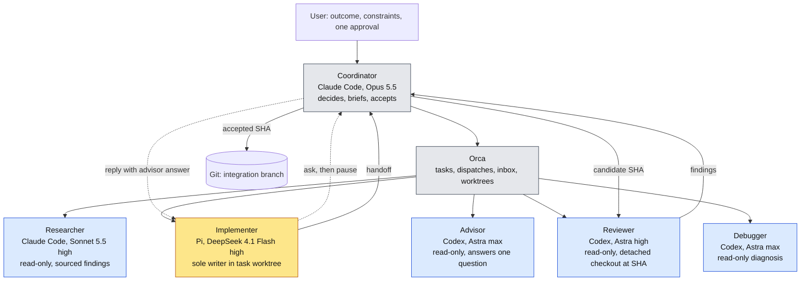

# Agentic SDD orchestration: planning package

Version 0.4, 14 October 2026. Planning only. P0 stays open until an authorized feasibility spike supplies evidence. Nothing here authorizes installation, execution or the spike.

## Agent fan-out

One coordinator, one manager, five on-demand specialists. Only the implementer writes product code. Every specialist is a leaf and spawns nothing (A-2).

Yellow: writes product code. Blue: read-only. Grey: control plane. Dotted lines are the Q-1 to Q-4 advice loop; the advisor runs while the implementer is paused.

## Read in this order

1. [Specification](orchestration-spec.md): objective, roles, modes, invariants, lifecycle, acceptance scenarios, decisions, limitations.
2. [Controls](orchestration-controls.md): every mechanical control with its tier, plus the brief, receipt and audit schemas.
3. [Plan](orchestration-plan.md): work packages, spike checklist, pilot thresholds, open inputs.
4. [Changelog](CHANGELOG.md): version history, AC renumbering, and the two v0.4 decisions that still need confirmation.

## Conventions

- Each rule is stated once. Other documents cite its ID: invariants A, C, W, L, Q, R, I; controls K-n; work packages P-n; decisions D-n; non-claims N-n.
- Tiers: **T0** required for the manual spike, **T1** required before any managed pilot dispatch, **T2** routine operation after adoption and may be relaxed by a recorded decision.
- "Feature spec" and "feature plan" are the per-feature product documents the coordinator writes. "This spec" and "this plan" are the orchestration documents in this package.

## Archive

`archive/v0.3/` holds the previous package unchanged, including the research notes and the earlier kickoff runbook. Those two contain superseded choices (native Claude researcher, `.claude/orca-sdd/roles/`, `sdd-researcher` definition, debugger ownership transfer). Current documents take precedence.
