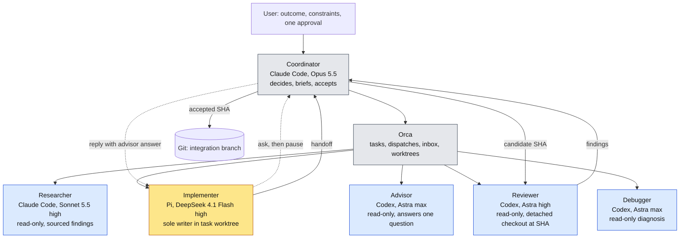

# Agentic SDD orchestration: planning package

Version 0.5, 14 October 2026. Planning package with P0 closed on spike evidence (`spike/2026-10-14-p0b.md`). Nothing here authorizes installation or implementation.

## Agent fan-out

One coordinator, one manager, five on-demand specialists. Only the implementer writes product code. Every specialist is a leaf and spawns nothing (A-2).



Yellow: writes product code. Blue: read-only. Grey: control plane. Dotted lines are the Q-1 to Q-4 advice loop; the advisor runs while the implementer is paused.

## Workflow

Target workflow once P6 is complete. Nothing is installed today. Every Orca command below was exercised in the P0b spike on 14 October 2026; the packaged entrypoint and automation are still to be built (P1 to P6).

### One-time setup, per machine or repository

1. Register the repository in Orca if it is not already open there:
   ```sh
   orca repo add --path /abs/path/to/repo --json
   ```
2. Install Orca's skills into the participating agents. Drop `--local` for a global install:
   ```sh
   orca skills install --skill orca-cli --skill orchestration --local
   ```
3. Install the SDD pack (installer delivered in P6; invocation to be named then). It places `sdd-orchestrator.md` in `.claude/agents/` and the role pack in `.agents/orca-sdd/` at the chosen scope (I-1 to I-3).
4. In Orca settings, set Agent Permissions to Manual so native permission controls stay in force (A-4, A-5).
5. Commit the pack and project instructions. Fresh worktrees contain only committed content (W-2).

### Start a feature

1. Pick the integration checkout. Any checkout on a feature branch works, including the primary one Orca opened, as long as it is clean and you note its base SHA (W-1, W-2). A separate Orca worktree is preferable when the primary checkout carries local changes or you run more than one feature; create it in the Orca app from the intended base branch. Sidebar parentage does not set the Git base. The headless equivalent is `orca worktree create --repo id:<repoId> --name feat-<name> --base-branch <intended-base> --json`; without `--base-branch` Orca uses the repository's configured base ref. Either way, confirm the SHA afterwards with `git rev-parse HEAD` in the new checkout.
2. Open an Orca terminal in that worktree and start the coordinator there. It must be an Orca terminal, because every orchestration command needs the terminal's identity (K-20). The `--agent` flag applies the entrypoint's system prompt, tools and model to the main session:
   ```sh
   claude --agent sdd-orchestrator
   ```
3. Give it the goal. Two prompt shapes:

   Planning-only (M-1):
   > Plan this feature in planning-only mode. Goal: [outcome]. Constraints: [list]. References: [tickets, docs]. Research unknowns, draft the feature spec, plan, task boundaries and acceptance checks, then stop and return open decisions. Do not implement, install or dispatch implementation workers.

   Full lifecycle (M-2):
   > Deliver this feature. Goal: [outcome]. Constraints: [list]. References: [tickets, docs]. Produce or validate the feature spec and plan, then pause for my approval before any implementation.

### What the coordinator does from there

No further user action until the approval pause or a blocker.

1. Loads the live Orca contract and checks state:
   ```sh
   orca skills get orchestration --full
   orca status --json
   orca orchestration run-create --objective "<feature outcome>" --json
   ```
2. Researches unknowns through Orca (K-3), writes or validates the feature spec and plan, and splits the work into bounded tasks (K-4).
3. M-1: returns the documents and stops. M-2: presents the documents and waits for one approval (D-1), then records it.
4. Per task: `task-create`, task worktree from the accepted SHA, brief preflight (K-2), `worker-start`, ownership gate (K-7), candidate commit (K-6), two-pass review (K-9), integration (W-4).

Pi is launched with the user's tested command and then attached, because Orca's per-worker model and effort overrides do not cover Pi:
```sh
orca terminal create --worktree path:<abs-task-worktree> --title implementer --command '<tested Pi DeepSeek command>' --json
orca terminal wait --terminal <handle> --for tui-idle --timeout-ms 60000 --json
orca orchestration worker-start --task <taskId> --worktree path:<abs-task-worktree> --terminal <handle> --json
```
Codex specialists are launched the same way with an explicit sandbox, because Orca otherwise pre-fills its bypass flag (K-21):
```sh
orca terminal create --worktree path:<abs-review-checkout> --title reviewer --command 'codex --sandbox read-only --model gpt-6-astra -c model_reasoning_effort="high"' --json
```
Codex may stop on an update prompt or a workspace-trust prompt before it is idle; `terminal wait` reports these as `blockedReason`.

### How results flow back

All specialist traffic goes through Orca's Run inbox. Nothing is passed by file or shared conversation (C-1, A-2).

| Direction | Mechanism |
| --- | --- |
| Coordinator to worker | `worker-start` injects Orca's preamble (task and dispatch IDs, reporting commands) followed by the full role text and brief. A later nudge uses `send --to dispatch:<id>`, which the worker only sees when it runs `check` at a checkpoint. |
| Worker done | Exactly one `send --type worker_done --task-id --dispatch-id --outcome succeeded\|failed` with the C-3 result fields in the body. For the implementer this is a handoff, not a candidate (L-1). |
| Worker question | `ask --to <coordinator> --question ... --timeout-ms ...` blocks the worker. Timeout leaves it pending (Q-3). |
| Coordinator reads | `check --wait --types worker_done,escalation,question` returns the oldest unacknowledged delivery. The coordinator validates it against the expected dispatch and candidate (R-2), acts, then `check --ack <deliveryId>`. |
| Coordinator answers | `reply --id <messageId> --body ...` to the original question after the advisor dispatch is read directly with `worker-show` and `worker-read` (K-10). |
| Code | Never in a message. The implementer leaves changes in its task worktree; the coordinator inspects, stages and commits the candidate SHA (K-6). Reviewers read that SHA in their own detached checkout. |

Deliveries are FIFO and replayable, which is why one `worker_done` per dispatch and identity checks before acceptance matter (K-12, N-5).

### Resume or cancel

- **Resume:** open the same integration worktree, run `claude --agent sdd-orchestrator`, and say "Resume the run for [feature]; reconcile first." The coordinator reconciles recovery index, audit log, Orca and Git before any new dispatch (R-2).
- **Cancel:** tell the coordinator to cancel. It stops new dispatch, stops workers through Orca and reports any uncertain state (R-3). Closing the coordinator terminal does not stop workers or remove worktrees.

## Read in this order

1. [Specification](orchestration-spec.md): objective, roles, modes, invariants, lifecycle, acceptance scenarios, decisions, limitations.
2. [Controls](orchestration-controls.md): every mechanical control with its tier, plus the brief, receipt and audit schemas.
3. [Plan](orchestration-plan.md): work packages, spike checklist, pilot thresholds, open inputs.
4. [Changelog](CHANGELOG.md): version history, AC renumbering, and the two v0.4 decisions that still need confirmation.

## Conventions

- Each rule is stated once. Other documents cite its ID: invariants A, C, W, L, Q, R, I; controls K-n; work packages P-n; decisions D-n; non-claims N-n.
- Tiers: **T0** required for the manual spike, **T1** required before any managed pilot dispatch, **T2** routine operation after adoption and may be relaxed by a recorded decision.
- "Feature spec" and "feature plan" are the per-feature product documents the coordinator writes. "This spec" and "this plan" are the orchestration documents in this package.

## Archive

`archive/v0.3/` holds the previous package unchanged, including the research notes and the earlier kickoff runbook. Those two contain superseded choices (native Claude researcher, `.claude/orca-sdd/roles/`, `sdd-researcher` definition, debugger ownership transfer). Current documents take precedence.
