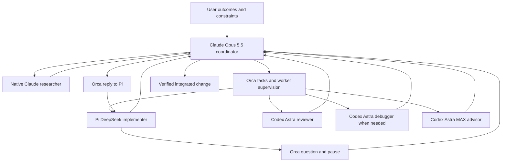

# Agentic SDD orchestration with Claude Pi and Orca

Research date: October 14, 2026. SDD means spec-driven development here.

This document is supporting research. The current draft requirements and implementation sequence are in `orchestration-spec.md` and `orchestration-plan.md`. Implementation is deferred pending review; earlier generated code is an unadopted prototype.

Use one Claude Code session running **Opus 5.5** as the project coordinator, **Orca as the task and worker manager**, **Pi exclusively for DeepSeek implementation**, and **Codex for every OpenAI specialist**. The pattern is a supervisor running a staged development workflow: specify, plan, implement, verify, review, and integrate, with bounded repair loops. Six roles do not require six permanently running agents.

This is a proposed implementation, supported by current documentation and local CLI inspection. The user has confirmed and tested **DeepSeek High working with Pi**. That configuration is an established input to the design. No agent configuration was changed by this research and the combined orchestration workflow has not been tested.

The responsibility split is important. Claude decides what happens next and whether work meets the specification. Orca persists tasks, dependencies, dispatch attempts and messages, and manages workers. An Orca Run is a durable namespace and coordinator inbox; it does **not** automatically schedule workers. Claude must operate the dispatch loop. [Orca orchestration](https://www.onorca.dev/docs/cli/orchestration)

| Role | Recommended agent and model | Responsibility |
| --- | --- | --- |
| Orchestrator | Claude Code, **Opus 5.5**, `claude-opus-5-5` | Own specification, plan, task boundaries, sequencing, integration and acceptance. |
| Implementer | Pi, **DeepSeek V4.1 Flash**, high | Use the user's tested configuration. Implement one bounded task, preserve invariants, run checks and report evidence. |
| Reviewer | Codex, **GPT-6 Astra**, high; max for difficult changes | Independently evaluate the frozen candidate against acceptance criteria, regression risks and tests. Return findings, without editing the candidate. |
| Debugger | Codex, **GPT-6 Astra**, max | Reproduce an unclear failure, test hypotheses and identify the cause. Return a focused repair plan or take over edits after explicit ownership transfer. |
| Mid-task advisor | Codex, **GPT-6 Astra**, max | Answer a specific implementation question while Pi pauses. Claude launches the advisor through Orca and replies to Pi's pending question. |
| Researcher | Native Claude subagent, **Sonnet 5.5**, high | Resolve scoped questions from primary documentation and repository evidence. Escalate consequential or ambiguous synthesis to Opus or the existing Astra advisor. |

These are routing recommendations, not a measured ranking on your projects. Astra is OpenAI's strongest general model for demanding coding and reasoning; its API supports `max`. Sonnet 5.5 is a practical research default because Anthropic positions it for faster, lower-cost, well-scoped work. If review cost is excessive, evaluate **GPT-6.1 Sol high** as the routine reviewer, retaining Astra for complex findings and debugging. [Astra](https://developers.openai.com/api/docs/models/gpt-6-astra), [Sol](https://developers.openai.com/api/docs/models/gpt-6.1-sol), [Sonnet 5.5](https://www.anthropic.com/claude-sonnet-5-5), [Opus 5.5](https://www.anthropic.com/claude-opus-5-5)

Preserve the user's working Pi/DeepSeek launch configuration. OpenAI authentication and model selection stay in Codex. Pi needs only its implementation tools and access to Orca's coordination commands; it does not launch or manage specialist agents.



**Why Orca fits this setup.** It supports Claude, Codex and Pi, and already provides structured orchestration state, dependency readiness, dispatch identities, inboxes and decision gates. Use Orca as the sole manager. [Orca supported agents](https://www.onorca.dev/docs/agents/supported), [Orca CLI](https://www.onorca.dev/docs/cli/reference)

There is one separate manager integration detail: Orca's current documented per-worker model and effort overrides exclude Pi. A public issue also reports rejected Pi overrides. Launch Pi using the user's already-tested configuration, then attach that existing terminal to the Orca task. This avoids requiring Orca to select Pi's model. Pi/DeepSeek itself is validated; task delivery and supervision through Orca still need testing on the installed versions. [Orca launch documentation](https://github.com/stablyai/orca/blob/main/docs/site/content/docs/cli/orchestration.mdx), [Pi override issue](https://github.com/stablyai/orca/issues/23388)

Illustrative manager sequence, with placeholders obtained from real receipts:

```sh
orca terminal create --worktree path:<absolute-worker-worktree> \
  --title implementer --command '<user-tested Pi DeepSeek High launch command>' --json
orca terminal wait --terminal <returnedHandle> \
  --for tui-idle --timeout-ms 60000 --json
orca orchestration worker-start --task <taskId> \
  --worktree path:<absolute-worker-worktree> --terminal <returnedHandle> --json
```

Pass the terminal's worktree explicitly: the default `current` refers to the coordinator's worktree. `worker-start` injects the task and preamble automatically; do not send the task again. The existing-terminal path grants supervised lifecycle ownership. A lower-level `dispatch --inject` does not provide equivalent supervision. Keep dispatch IDs on results so a late response from an old attempt cannot be accepted as the current attempt. Durable messages also do not imply immediate interruption: workers must check for messages at checkpoints. [Worker command specification](https://github.com/stablyai/orca/blob/main/src/cli/specs/orchestration-worker-specs.ts), [bundled guide](https://github.com/stablyai/orca/blob/main/src/cli/bundled-skill-guides.ts), [Orca topology](https://github.com/stablyai/orca/blob/main/skill-guides/orchestration/references/low-level-topology.md), [worker contract](https://github.com/stablyai/orca/blob/main/skill-guides/orchestration/references/worker-contract.md)

**Worktree ownership follows the code task.** Orca owns creation and lifecycle; Claude chooses placement and the exact Git starting point. A new agent session does not require a new worktree. The proposed policy is one feature integration checkout plus one separate checkout per concurrent implementation task, reused across that task's implementation, consultation and review.

| Role | Checkout and ownership |
| --- | --- |
| Coordinator | Feature integration worktree. Owns specification, plan and acceptance; integrates accepted task changes serially. |
| Implementer | Task worktree created from a recorded accepted integration revision. Sole source-code writer while assigned. |
| Advisor | Read-only inspection of the paused implementer's worktree, including uncommitted files, or an explicitly captured diff. No new checkout needed for consultation. |
| Reviewer | Fresh session examining the frozen task candidate read-only. Pin the commit or diff; pause writes while reviewing. |
| Debugger | Diagnose read-only against that candidate. If it must edit, stop the implementer and transfer ownership, or give it a separate repair worktree containing the same candidate. |
| Researcher | Read-only access to the relevant checkout, with explicit source paths and a bounded research question. |

Create new task worktrees from an explicit base ref and record the resolved commit. Orca exposes `--base-branch` for new worktrees, and the worktree model supports a start-from branch or commit. Sidebar parentage alone does not determine Git history. After integrating task A, start dependent task B from the newly accepted integration revision. If worktrees already exist, explicitly reconcile their base before dispatch. [Orca worktrees](https://www.onorca.dev/docs/model/worktrees), [placement guide](https://github.com/stablyai/orca/blob/main/skill-guides/orchestration/references/placement-and-remote.md)

New checkouts do not automatically contain the coordinator's uncommitted specifications, untracked role files, ignored dependencies or local configuration. Version role files, shared instructions and approved specifications before branching, or include the required text directly in the task payload. Run repository setup and verify readiness before work requiring it: `--setup run` can run concurrently with the agent under the repository's start-immediately policy, while wait-for-setup gates task input. Copy only approved nonsecret local assets; do not broadly copy environment files or share mutable build state. Preserve task worktrees and evidence until integration and verification succeed. Worker terminal release and worktree removal are separate operations; releasing a worker does not remove its checkout. [Worktree setup](https://www.onorca.dev/docs/model/worktrees), [worker lifecycle](https://github.com/stablyai/orca/blob/main/src/cli/specs/orchestration-worker-specs.ts)

**Role selection is an explicit launch contract.** Orca's `--agent` selects the enabled agent runtime, such as `codex` or `pi`. Its current worker-start command has no general `--role` switch. Model and effort overrides select inference settings; a specialist's instructions must also be supplied. [Worker-start specification](https://github.com/stablyai/orca/blob/main/src/cli/specs/orchestration-worker-specs.ts)

Keep a small role table in the coordinator instructions: role name → runtime, model, effort, role prompt, permission settings and worktree policy. This is a convention interpreted by Claude, not a new configuration format Orca automatically loads. For Pi and Codex, the coordinator reads the selected role Markdown and includes its actual instructions with the task specification. Native launch settings enforce the appropriate sandbox/tool access. If a needed runtime flag is not exposed by Orca, launch that configured terminal natively and attach it using the supported existing-terminal path, as with Pi.

For example, a review assignment resolves to `reviewer` → Codex → Astra High → reviewer instructions → read-only native settings → the exact task candidate. An advisory assignment resolves to `advisor` → Codex → Astra Max → advisory instructions → read-only native settings → the paused implementer's changes. A terminal title such as reviewer is only a label; it does not install those instructions or restrictions. Claude's native researcher continues to use its `.claude/agents/sdd-researcher.md` definition. Codex `.codex/agents/*.toml` definitions configure Codex's internally spawned subagents; do not assume an external Orca-launched Codex session automatically selects one by its name. [Claude native roles](https://code.claude.com/docs/en/sub-agents), [Codex custom subagents](https://learn.chatgpt.com/docs/agent-configuration/subagents)

**Every specialist receives explicit context.** Treat new external sessions as fresh contexts; the Claude coordinator's conversation is not automatically transferred. Assemble four layers:

1. **Project rules:** applicable AGENTS.md instructions, relevant architecture and project checks available in the selected checkout.
2. **Role instructions:** responsibility, permitted actions, escalation policy, output contract and delegation limit. External workers do not create further specialists.
3. **Task brief:** objective, acceptance criteria, owned paths, interfaces/invariants, accepted decisions, relevant predecessor results, exact base/candidate, required checks and expected deliverable. Include concise source pointers instead of the whole coordinator transcript. Make pending uncertainty explicit.
4. **Orca execution context:** the injected task/dispatch identity, coordinator routing and lifecycle/reporting commands. Follow the live preamble rather than reconstructing those fields.

Dependency edges determine ordering; include the needed predecessor conclusions and artifacts in the brief instead of assuming an edge supplies their content. For advisory calls include the current question, hypotheses, failed attempts and observed errors. For review include the acceptance criteria, candidate diff, test evidence and known limitations; request an independent inspection. For debugging include a reproducer and expected versus observed behavior. Stop and ask the coordinator if referenced artifacts or the expected revision are missing.

On resume, retain an explicit session ID only for the same role and continuing task. Use a fresh session when changing role or task; the advisor and reviewer can share a model while retaining independent contexts. Keep concise outcomes and evidence pointers in the Orca task record and repository recovery note, so the coordinator can reconstruct progress without replaying every transcript.

**The development loop.** Maintain specification and design artifacts in the repository, with Orca holding operational task state. This follows the standard SDD progression from requirements to specification, plan, tasks and implementation; it does not require installing another SDD framework. [GitHub's SDD description](https://github.com/github/spec-kit)

| Stage | Action | Evidence required to advance |
| --- | --- | --- |
| Discover | Claude identifies unknowns; researcher resolves bounded questions. | Source-backed findings, assumptions and unresolved product decisions. |
| Specify | Claude writes expected behavior, non-goals and acceptance criteria. | Observable criteria, labelled AC-1, AC-2, etc.; material ambiguities resolved. |
| Design and slice | Claude writes the plan, interfaces and dependency-ordered task contracts. Consult Astra on difficult decisions. | Owned paths, base revision, dependencies, constraints and checks for each task. |
| Implement | Pi changes one task's worktree and runs relevant checks. | Candidate diff, outcomes of checks and known gaps. |
| Consult or diagnose | Pi asks Claude for help through Orca; Claude assigns the Codex advisor or debugger. | Supported next action or reproducer and cause. |
| Review | Independent Codex reviewer examines the precise candidate and its contract. | Findings with locations, consequence and verification; acceptance-criteria coverage. |
| Integrate and accept | Claude resolves findings, integrates accepted changes serially and reruns required checks. | Integrated result satisfies each criterion; checks and limitations recorded. |

The orchestrator should continue within the approved objective without asking the user at every stage. Escalate actual product ambiguities, scope changes or actions requiring authorization. A specialist's successful exit or `worker_done` message reports execution status; acceptance still requires evidence.

Claude's loop is: inspect ready tasks, dispatch bounded work, wait on the Orca inbox, inspect results and checks, then accept, request repair or escalate. Repeat until the objective is satisfied or a genuine blocker requires input. Orca can settle a task when a valid worker completion arrives, so dependent implementation must be gated by the relevant review/integration outcome, not simply by the predecessor implementer's completion. Keep those stages explicit in the task dependencies.

Start with **one writing implementer** and parallelize research or independent read-only analysis. After the pilot, allow two writers only when their task interfaces and file ownership are compatible. A worktree prevents live file collisions but does not eliminate integration conflicts. Create workers from an explicit accepted revision, prepare their dependencies, freeze a candidate for review, and invalidate affected review evidence when the candidate changes.

A useful task contract contains: objective; linked acceptance criteria; exact base revision; owned paths; dependencies; interfaces and invariants; permitted actions; required checks; and expected result. A result contains: dispatch/session identity; outcome; changed paths; candidate revision or diff; checks actually run; failures or unavailable checks; and remaining questions. Give the smaller implementer necessary implementation constraints and examples, not merely a vague desired outcome.

Use bounded repair rules as a starting policy: after two failed approaches, consult the advisor; after two unproductive consultations or an unclear reproducible failure, request the debugger. Set a task-level time or attempt budget. Never keep retrying merely because a worker has not produced a success message. Inspect uncertain delivery or timeout states before redispatching.

**The advisor uses Orca's existing question and reply flow.** Pi remains an implementation worker throughout. It neither spawns a Codex process nor needs a subagent extension. Claude owns every specialist dispatch.

1. Pi supplies the task criterion, question, relevant files or diff, attempted approaches and observed failures through Orca's `ask` command, then pauses edits.
2. Claude receives the pending question and dispatches a bounded **Codex Astra Max** advisory task. The advisor inspects the paused worker's current worktree read-only, including relevant uncommitted changes, or receives an explicitly captured candidate diff.
3. The advisor returns a concise recommendation, evidence, uncertainty and a verification step. It does not implement the change.
4. Claude evaluates the answer and uses Orca's `reply` command with the original question message ID.
5. Pi receives the reply, resumes the same task, applies the advice and verifies the result.

The advisor must be runnable while the implementation task is still open: do not give it a dependency on implementation completion. Reserve capacity for an advisor or debugger when a worker is waiting. Keep review as a separate assignment after the candidate is ready.

Preserve the original question ID and its advisor dispatch ID. Orca can replay the oldest unacknowledged delivery, so do not hold the question delivery while expecting the next consuming inbox check to return the advisor result. For the initial sequential implementation, inspect the advisor dispatch directly with `worker-show` and `worker-read`, then reply and acknowledge the question delivery. Follow the installed guide if later adopting deferred acknowledgements. Verify the implementation dispatch is still active before replying, and return a bounded failure/escalation if the advisor cannot finish rather than leaving Pi waiting indefinitely. [Orca coordinator loop](https://github.com/stablyai/orca/blob/main/skill-guides/orchestration/references/coordinator-loop.md)

Illustrative existing Orca commands; identifiers come from the active run and receipts:

```sh
# Pi asks its coordinator and waits.
orca orchestration ask --to <coordinatorHandle> \
  --question '<bounded question with context and evidence>' \
  --timeout-ms 60000 --json

# After the Codex advisor returns, Claude answers that same question.
orca orchestration reply --id <questionMessageId> \
  --body '<advisor recommendation and verification step>' --json
```

“Mid-turn” means within the ongoing task at a deliberate tool boundary. Pause other edits before asking. An `ask` timeout is not permission to resume editing: the question remains pending and should be resumed by message ID until answered or explicitly cancelled. Regular `send` only queues a message; it does not provide this blocking handoff. This design needs no Pi subagents, Pi RPC controller, custom advisor extension or continuous monitoring process. [Orca worker contract](https://github.com/stablyai/orca/blob/main/skill-guides/orchestration/references/worker-contract.md), [Orca messaging](https://github.com/stablyai/orca/blob/main/skill-guides/orchestration/references/messaging-and-gates.md)

**Keep configuration small.** Use the installed Orca orchestration skill as the source of manager commands. Define the Claude coordinator and researcher with native agent Markdown. Keep one Pi implementer prompt and separate Codex advisor, reviewer and debugger prompts. Each Codex assignment gets its own context, selected model, effort and appropriate sandbox. Codex's native CLI supports bounded jobs, final-response files, JSON events and structured final schemas. There is no need to wrap everything in the Agents SDK or add a custom MCP server. [Orca skills](https://www.onorca.dev/docs/cli/skills), [Claude agents](https://code.claude.com/docs/en/sub-agents), [Codex non-interactive mode](https://learn.chatgpt.com/docs/non-interactive-mode)

Suggested repository layout, not files installed by this research:

```text
AGENTS.md                         shared project rules
CLAUDE.md                         @AGENTS.md plus Claude-specific instructions
.claude/agents/sdd-orchestrator.md     native main-agent definition
.claude/agents/sdd-researcher.md       native researcher definition
.claude/orca-sdd/roles/                     Pi and Codex role prompt files
specs/<feature>/spec.md            behavior and acceptance criteria
specs/<feature>/plan.md            design, interfaces and task contracts
.agent-task.md                    recovery pointer and latest accepted state
```

Keep task progress in Orca rather than manually maintaining a second competing queue. The recovery note should point to the Orca run, active dispatch/session IDs, worktrees, spec, evidence and next action. On resume, inspect actual manager and Git state before launching more work. Current Claude supports conditional AGENTS.md loading; the explicit `@AGENTS.md` import is useful where Claude-specific instructions already exist. [Claude memory](https://code.claude.com/docs/en/memory#agentsmd)

Do not add Claude Agent Teams initially. They are still experimental, and ordinary native Claude subagents already support focused role delegation. Pi and Codex remain external worker processes, not Claude-native subagents. Adding teams would create another coordination layer above Orca. [Claude teams](https://code.claude.com/docs/en/agent-teams)

One real setup default needs attention: Orca documents launch defaults that bypass Claude permissions and Codex's sandbox/approvals. Set Agent Permissions to Manual and inspect any per-agent overrides, preserving the intended native controls. Use Codex's read-only sandbox for review, and an appropriate isolated environment for Pi's write-capable execution. Git worktrees isolate changes, not host access. [Orca permission settings](https://www.onorca.dev/docs/agents/supported), [Codex security](https://learn.chatgpt.com/docs/agent-approvals-security)

**What to retain from the supplied resources.**

| Resource | Useful contribution and qualification |
| --- | --- |
| [Burke Holland gist](https://gist.github.com/burkeholland/0e68481f96e94bbb98134fa6efd00436) | Central coordinator, task decomposition and ownership. Its configuration targets VS Code/Copilot; agent syntax and model labels do not transfer directly. Avoid blanket full-file rewrites and compulsory parallelism. |
| [Nimbalyst article](https://nimbalyst.com/blog/orchestrating-claude-code-and-codex-together/) | Written handoffs and independent cross-agent review. Its assertion that Claude does not read AGENTS.md is outdated against current Claude documentation. |
| [Firecrawl article](https://www.firecrawl.dev/blog/codex-multi-agent-orchestration) | Useful distinction between in-session subagents and worktree-based parallel execution. Its model examples and some configuration keys are dated; verify against current Codex docs. |
| [Developers Digest patterns](https://www.developersdigest.tech/blog/seven-ai-agent-orchestration-patterns) | Supervisor plus pipeline is the closest conceptual fit. A recursive management hierarchy is unnecessary for the proposed starting setup. |
| Four linked YouTube videos | Pages and titles were retrieved, but usable transcripts were not. No technical conclusions here depend on claiming to have watched or transcribed them. |

Another compatibility issue matters if an older tutorial suggests exposing Codex through MCP: **`codex mcp-server` and the standalone MCP-server binary have been removed**. Use the native CLI for this lean setup. The replacement app-server protocol is a different interface and remains experimental. [Official removal notice](https://learn.chatgpt.com/docs/mcp-server)

**Implement in one small pilot.**

1. Load the installed Orca CLI/orchestration guides and preserve native permission settings. Reuse the tested Pi/DeepSeek High configuration and confirm the Codex specialist profiles.
2. Define the coordinator, researcher and external role prompts. Create a small feature specification and task contract in a non-production repository.
3. Attach one correctly configured Pi implementer to an Orca task. Confirm it receives the task instructions and produces one completion tied to the correct dispatch.
4. Exercise one Codex Astra consultation through Orca's question/reply flow and one deliberate failing test. Confirm Pi stays paused across question timeouts, receives the answer, uses the advice, and escalates to the debugger when required.
5. Review the exact candidate independently, integrate it, and rerun relevant checks. Test interrupted-task recovery before increasing concurrency.

Record accepted tasks, missed defects, review findings rejected as incorrect, repair attempts, elapsed time and model usage. Compare the setup on a normal feature, a regression and a difficult diagnosis before optimizing model routing. The proposal succeeds when task state survives interruption, only the assigned worker writes, advisor help is usable, and acceptance evidence matches the integrated code.

Verification performed during the initial research: three focused Context7 commands for each assigned documentation topic, primary-source web research, Codex CLI 0.161.0 help/version inspection, and Pi 1.0.4 help, packaged docs and public model-catalog inspection. The user subsequently confirmed testing DeepSeek High with Pi; this revision accepts that as validated. Orca was not found in this shell's PATH; that does not establish whether the desktop app is installed. Codex specialist launches, Pi attachment to Orca, task delivery, advisor question/reply, completion, cancellation and recovery remain untested as a combined workflow. The four video transcripts were unavailable. No agent settings were changed.

The worktree and role/context follow-up used three additional Context7 commands and inspected Orca's current worker command specification, placement guide and worker contract. It confirms that role selection needs explicit instructions alongside runtime selection. The resulting policies remain proposed configuration, not installed behavior.
