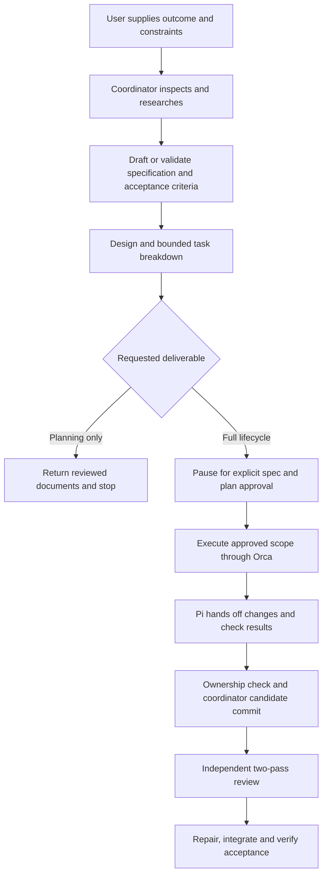

# Agentic SDD orchestration — draft implementation plan

Version: 0.3 · Date: 14 October 2026 · Status: **Planning only; implementation and the feasibility spike are deferred.**

The companion `orchestration-spec.md` defines requirements and acceptance scenarios. `orchestration-contracts.md` defines the task/result, preflight and audit contracts. This document sequences later implementation and verification. The existing installer and runbook are unadopted prototypes; they provide neither design approval nor authorization to run them.

## 1. Architecture and lifecycle

Use Claude as the coordinator and Orca for the cross-CLI task, session, messaging and worktree capabilities this workflow needs. A thin native Claude entrypoint loads the shared workflow and role map. Every specialist, including research, receives an ordinary role prompt and explicit task contract through the same external Orca dispatch path. Native launch settings select the runtime, model, effort and permissions. Specification drafting, file operations, research tools and ordinary Git checks stay with the native agents/tools; they need no separate Orca task. Keep supported launch recipes; do not build an adapter framework.

The baseline remains Claude Opus 5.5 coordinating; the user's tested Pi/DeepSeek 4.1 Flash high configuration implementing; Codex Astra max advising/debugging and high reviewing; and Claude/Sonnet 5.5 high researching. Research can be rebound to a verified Codex recipe without changing its role or result contract. The implementer retains writing ownership; other specialists return findings. Start with one implementation writer.

Repository documents own intended behavior and design, Orca owns operational tasks/messages, and Git owns code revisions. An ignored recovery note and append-only audit log connect those records. A brief linter and small logging/budget utilities are permitted v1 support code after feasibility; they do not schedule tasks or replace Orca. If a required Orca contract fails feasibility, stop and revise the integration explicitly.

Every run follows discovery, specification, planning and task breakdown before coding. The user need not pre-author those documents. Validate and reuse existing documents when current and complete. **D-1 is settled:** pause once for explicit approval of the feature specification and plan; then execute within that approved scope. Routine assignments, reviews and bounded repairs need no additional approval. A material change to the approved behavior/design invalidates that approval. Planning-only requests stop at documents; a later instruction must authorize progression beyond that deliverable. A future policy that skips upfront approval is a phase-two option, outside v1; the P0–P7 labels below are work packages for building the orchestration system.

The current request authorizes documentation only. Approval of these drafts does not silently authorize a live spike, installation or pilot. Obtain scoped authorization for that later work when its concrete plan is ready.

## 2. Artifacts and ownership

Use existing repository conventions for feature documents. Proposed shared-pack locations are `~/.agents/orca-sdd/` globally or `<project>/.agents/orca-sdd/` locally. These are explicitly read files, not automatic role discovery. The initial coordinator entrypoint lives in the matching `.claude/agents/` scope; a project override replaces its matching entrypoint/pack as a unit.

| Artifact | Owner and purpose |
| --- | --- |
| Thin coordinator entrypoint | Native startup/tool configuration and pack selection |
| Shared workflow, role map and five specialist prompts | Coordinator routing, role boundaries and verified native launch recipes |
| Feature specification and plan | Coordinator-maintained behavior, acceptance criteria, design and bounded tasks |
| Task/result contracts and brief linter | Explicit context and mechanical readiness checks; see contracts appendix |
| `.agent-task.md` | Coordinator-only recovery index in the feature integration checkout; Git-ignored |
| `.agents/orca-sdd/runs/<feature-id>/events.jsonl` | Coordinator-only append-only audit log in that integration checkout; Git-ignored |

Record the absolute integration checkout, recovery-note and event-log paths in run metadata so restart can locate them. Verify ignore rules before use: ignore `.agent-task.md` and the runtime `runs/` subtree, not the versioned role pack. Task writers cannot own or modify specification, plan, role/workflow, recovery or audit paths. Supply required document text or pinned references to workers without copying writable coordinator state into their checkout.

The task brief pins both specification and plan revisions/content hashes. The audit log records those hashes and the brief hash alongside Orca run/task/dispatch identifiers. A brief hash is evidence of content, not a unique execution identity. Redact sensitive material; log references and operational facts rather than unrestricted prompt/transcript dumps.

## 3. User workflow

**One-time setup, later:** confirm feasibility evidence, native clients and effective permissions; preserve authentication and the tested Pi configuration; choose global/project scope; preview and install the reviewed pack. Packaging follows the working pilot.

**Normal kickoff:** the user provides an outcome, constraints and references. Claude reads project instructions and actual state, conducts bounded research, produces or validates spec/plan/task breakdown, reviews readiness, and presents one explicit approval checkpoint. Record the approval against the exact document baseline and authorized scope. Once received, Claude executes within scope: prepares and delegates implementation, supervises advice/review/repair, integrates and verifies.

**Planning-only:** Claude performs the same initial stages and returns reviewed documents, acceptance checks and open decisions. Bounded repository-read-only research can use Orca against an existing checkout. This does not authorize implementers, installation, product dependency setup or the live feasibility spike.

**Resume:** reconcile the recovery note and audit log with actual Git/Orca state before any new dispatch. Resume the same role only for the continuing assignment. A restart does not replace missing approval, reset task budgets or make a stale result current.

## 4. Implementation sequence and exit gates

These are future work packages, not active tasks or permission to execute. P0 is deliberately incomplete until the live feasibility evidence exists.

| Step | Deliverable | Entry condition | Exit evidence |
| --- | --- | --- | --- |
| P0a — Settle assumptions | Reviewed architecture, spike scope and measurable pass/fail checklist | Documentation work | D-1 fixed; native restrictions, communication and failure cases specified; no claim that feasibility passed |
| P0b — Orca feasibility spike | Compatibility evidence on installed clients in a disposable repository | Explicit scoped authorization for the live spike | Maximum one working day/8 hours, with start/end recorded; prove launch/attach, exact context delivery, effective permissions, result reporting, ask/reply timeout, cancellation and recovery; include read-only research/reporting |
| P0c — Close feasibility | Accept/revise decision tied to spike evidence | P0b evidence | Every essential contract demonstrated; unresolved failures or exhausted timebox keep P0 open and stop downstream implementation |
| P1 — Contracts and thin utilities | Task/result schemas, preflight linter, append-only audit writer and usage/budget recording | Closed P0 and implementation authorization | Invalid briefs are rejected mechanically; event correlation and missing-telemetry detection verified; no scheduling logic added |
| P2 — Roles and gates | Thin entrypoint, shared workflow, five prompts, native recipes, ownership/spec/review gates | P1 | AC-01/13/14 and AC-15–23 represented in executable checks or explicit observed scenarios; goal-only request plans before coding and pauses once |
| P3 — Prove one task | One Pi implementation through preflight, path gate, committed candidate, review and integration | P2 | Correct model, task identity, base, permitted paths, complete context and integrated checks; instrument all dispatches from the start |
| P4 — Consultation and recovery | Advisor/diagnosis exchanges and controlled interruption drills | P3 | Dirty-file advice, two-pass review, correlated timeout handling, restart, cancellation and spec change demonstrated without weakening controls |
| P5 — Measured pilot | Ten completed implementation tasks, calibration and required drills | P3/P4; authorized pilot scope | Numeric criteria in section 7 met, with human-audited findings and measured usage |
| P6 — Package installation | Small global/project installer and operator documentation | Stable P1–P5 design | AC-10, offline default, scope precedence, preview, idempotence, backups and partial-failure behavior; repeat discovery and lifecycle checks with freshly installed entrypoints |
| P7 — Adoption decision | Evidence report, remaining limitations and adopt/revise outcome | P5/P6 evidence | All required acceptance scenarios and pilot thresholds satisfied; unmeasured required usage or missing safety/recovery evidence blocks adoption |

The P0 spike validates essential behavior directly with native clients and Orca before building the utility layer. Manual append-only records of measured native output and receipts are sufficient during the spike; telemetry starts with its first dispatch. P1 automates those proven collection paths, so its utilities are not a prerequisite to P0. At the eight-hour limit, stop and reassess; incomplete checks remain unresolved.

The critical spike checklist is:

| Question | Required observation |
| --- | --- |
| Can Orca attach to the tested Pi session and inject its task? | Correct native model/effort, exact bounded task received, one intentional injection, real task/dispatch identities and no blind resend after uncertain delivery |
| Can Codex remain read-only and still report? | A harmless attempted repository write is refused by the native control, while source inspection and correlated Orca/result delivery succeed |
| Can completion survive replay/restart? | Record the native receipt, inspect after a controlled restart and replay an identical completion; the procedure accepts one terminal result and surfaces a conflicting result rather than overwriting it |
| Does ask timeout preserve the question? | Pi remains paused after timeout; the advisor sees its dirty/new files; a reply to the original ID resumes the same assignment without inbox deadlock |
| What can Pi actually restrict, and what usage is measurable? | Demonstrate/document native write limits, manually detect a synthetic out-of-assignment change, and capture actual token or cost measurements for the tested runtimes and coordinator |

Record versions, command receipts, sanitized evidence and pass/fail/inconclusive for each row. Native Pi host containment is not assumed; a missing boundary must be explicit, with only disposable fixture work allowed until the accepted deployment scope addresses it. Lack of usable telemetry blocks the measured pilot. Full automated replay/ownership checks follow in P1/P2; the spike establishes native feasibility and the manual correlation procedure.

P6 may reuse reviewed prototype ideas only after comparison with final requirements. Installer language, helper filenames and implementation technique remain later choices.

## 5. Dispatch, scope and evidence

### Preflight and task sizing

Before every managed dispatch after the bounded manual spike, the coordinator selects a ready task whose predecessors have accepted results, supplies the full role and brief, and runs the brief linter described in `orchestration-contracts.md`. It verifies the seven required sections—identity, objective, context, workspace, execution, validation and delivery—plus accepted base, path ownership, linked acceptance criteria, available context, exact specification/plan revisions and hashes, mode-appropriate authorization, effective runtime settings and required checks. For initial research, first create minimal unapproved spec/plan snapshots containing goals and questions; the research brief may pin these drafts and a provisional question ID before product ACs exist. Implementation requires nonempty valid AC references and approved spec/plan committed at their pinned revisions. Bind runtime identifiers from actual receipts, not invented brief values. Missing or stale inputs block dependent dispatch rather than being repaired by worker guesswork.

Default task size is one outcome, at most five source/test files and at most 300 changed lines, excluding explicitly disclosed generated/lockfile changes from that sizing count. Those exclusions do not exempt paths from ownership checks. Target one 30–90 minute working session, with exact checks named in advance. At 90 minutes or an exceeded bound, checkpoint evidence and split the remaining work; a larger task requires a named, justified exception included in the approved plan or explicitly reapproved. Do not silently stretch tasks to avoid decomposition.

Create each implementation checkout from the recorded accepted integration commit and complete permitted setup before delivery. Keep one writer in that checkout. Required specs/instructions must be present or supplied explicitly. No secrets may be copied, written or mounted into task worktrees; use synthetic fixtures for checks. Required live-secret checks remain clearly deferred verification gaps. Native authentication remains in its existing supported store outside the task worktree; do not fabricate test success from fixtures.

### Mechanical ownership gate and candidate freeze

Inspect all changed paths against the brief's explicit allowlist before independent review. Include additions, deletions, rename source/destination and generated or untracked changes; specification, plan, roles and recovery files receive no special exemption. Any out-of-assignment change blocks the candidate. Preserve rejected work for diagnosis; do not silently delete it to make the gate pass. Coordinator-protected paths cannot become implementer-owned through a task exception.

The implementer hands off and pauses. Once ownership and required checks pass, the coordinator stages only the inspected assigned paths, deliberately creates the task-branch candidate commit and records its full SHA. Workers do not stage/commit or modify shared Git administration in v1. Do not commit arbitrary leftovers just to obtain a clean status. Uncommitted work is not reviewable as a final candidate. Run the reviewer in a separate detached checkout at that SHA and verify its clean state. Advice remains distinct: an advisor can inspect the paused implementer's dirty working checkout read-only, including newly created files.

### Independent two-pass review

Pass 1 receives the candidate diff, specification and acceptance criteria, neutral role/runtime metadata, applicable repository rules, and direct code access. Withhold plan rationale, implementer self-report, claimed check results, advisory exchanges and prior verdicts. The reviewer sends an interim report; the coordinator persists its findings immutably before supplying the self-report and check evidence for pass 2. This interim report is not terminal `worker_done`. Submit the single terminal review result after pass 2. Preserve both passes; later reconciliation must not overwrite the independent first judgment.

Route actionable findings to the writer in its original task checkout. Once a final result has been submitted, a repair that produces another final result requires a new dispatch identity. Produce a new candidate commit after repairs and invalidate affected review/check evidence. Integrate accepted commits serially and execute required checks on the integrated result. Downstream work is released from the accepted integrated revision, not merely from an Orca completion message.

### Specification and plan changes

On any spec/plan edit, compare its new content hash with every queued and in-flight brief. Revalidate all affected tasks, hold dependent work, and explicitly rebrief, replace or cancel assignments as appropriate. Reassess already-produced candidates and acceptance evidence. Material behavior/design/scope changes invalidate the human approval and require a new baseline approval; nonmaterial clarification still needs recorded impact analysis and updated references. Workers cannot redefine the specification to make their output pass.

## 6. Consultation, recovery and accounting

**Research:** use a bounded question, verified repository-read-only settings, permitted sources and required retrieval tools. Keep the same contract when testing Claude and Codex research bindings; compare compliance/evidence quality rather than identical prose. Tool limitations remain visible and do not justify bypassing permissions.

**Advice:** Pi pauses dependent edits and asks a concrete question. Claude records its original ID, keeps capacity available, and launches the independent advisor without a dependency on implementation completion. Inspect the advisor dispatch directly while holding the original inbox delivery; confirm the implementation assignment is still active, reply to that question and then acknowledge delivery. Timeout is neither a reply nor permission to resume. Diagnose uncertain delivery before retrying; repeated failure becomes an explicit blocked outcome. Consultation occurs at a supported tool/message boundary.

**Recovery and audit:** the single coordinator appends timestamped intent, receipt, result, acceptance/rejection decision, cost and error events to the feature JSONL log. Correlate Orca identities, brief/spec/plan hashes and candidate SHA. Preserve prior events; corrections are new entries. Before retrying after a crash, reconcile the last intent with actual Orca/Git state. Duplicate deliveries are allowed; at most one result can be accepted for a given dispatch, and superseded dispatch/candidate results are rejected. The log records what happened; it does not schedule what happens next.

**Cancellation:** stop new dispatch, cooperatively stop active workers through supported mechanisms, and verify the outcome. Resolve pending questions or record their cancellation. Retain incomplete changes and evidence. Report uncertain stopping states explicitly; terminal shutdown does not imply task cancellation or worktree removal.

**Usage:** create a usage record from the first dispatch, including failed/cancelled work, calibration and advisory/review/research sessions. Record native actual token counts or cost, elapsed time, model/effort and attributable coordinator session totals or before/after deltas. Native capability determines which counter fields exist, not whether a role is accountable. Every specialist dispatch and 100% of coordinator work attributable to the run must have measured actual token or cost coverage before pilot adoption; missing data is a blocker, not zero. Identify attribution limits and use another supported actual measurement if needed; estimates cannot fill the requirement. Mark estimates separately, and never treat a subscription as a zero-dollar task. No dollar cap is invented: record any user-approved cap and enforce it, otherwise report measured use and the task/time limits.

## 7. Verification and numeric pilot completion

Use an isolated, non-production repository. Capture automated checks, manual observations and untested assumptions separately, with evidence references to specification AC-01–24. Planning-only behavior and a goal-only full-lifecycle request must both be tested; the latter must generate/validate documents, pause for one approval, and execute within the approved scope. Recheck native restrictions and result communication together.

The proposed initial adoption thresholds are:

| Measure | Required evidence |
| --- | --- |
| Ordinary implementation sample | Ten completed tasks: four small features, three bug fixes and three integration/regression tasks, all meeting approved acceptance criteria |
| Integrity | Zero lost work, duplicate accepted results or unauthorized accepted changes across the pilot |
| Recovery drills | Three coordinator restarts, two ask timeouts, one cancellation during active implementation and one specification-change drill; all recover correctly with complete task/evidence accounting |
| Reviewer calibration | Score persisted pass-one findings on five seeded defects in isolated candidates distributed across pilot start/middle/end and five clean controls: detect at least four of five defects and every seeded critical/high defect; at most one false positive on the controls |
| Human intervention | At most two unplanned human interventions across the ten ordinary tasks; routine upfront approval per feature and planned drill/calibration actions excluded from this limit but separately counted |
| Usage coverage | A record for every specialist dispatch and coordinator session, with 100% actual native token or cost telemetry before adoption; failures, cancellations and calibration included |

Calibration candidates are separate from ordinary implementation tasks and must not introduce defects into accepted product work. A human validates the seed inventory, severity and clean-control ground truth, then audits detections and false positives. Withhold that ground truth until the completed review. Score the primary thresholds using the immutable pass-one findings; record additional valid pass-two discoveries separately. A human adjudicates genuine unseeded issues: if a control was not clean, record its correction/replacement rather than count a correct finding as a false positive. Record calibration position and outcomes so drift is observable. These small-sample thresholds are operational adoption gates, not a statistical performance guarantee.

An unplanned intervention is a human action needed to rescue ordinary orchestration or correct its decisions beyond the scheduled baseline approval; classify and record each one. Planned actions and extra approvals caused by changed requirements remain visible even when excluded from the ordinary-task threshold. Material safety/integrity failures require diagnosis and correction; accumulating ten successful tasks does not cancel a failed gate.

Also validate malformed/stale briefs, out-of-allowlist changes, uncommitted candidates, review anchoring controls, missing telemetry, secret-file exclusion, exceeded task bounds and log recovery. Run installer tests only in P6 and validate real native role discovery separately. Missing required live-secret validation remains an explicit acceptance gap, not an invented fixture-based pass.

## 8. Disposition of review flags and additions

| Item | Plan disposition | Specification/contract trace |
| --- | --- | --- |
| F1 — Feasibility before P0 closes | P0a/b/c; authorized one-day/8h spike and evidence-gated closure | AC-24 |
| F2 — Pick approval policy | One explicit spec/plan approval, then execution within scope; a future no-upfront-approval policy is outside v1 | D-1; lifecycle |
| F3 — Pi scope enforcement | Mechanical changed-path allowlist gate before review | W-5; AC-15 |
| F4 — Frozen review state | Clean task commit SHA; separate detached review checkout | Worktree/candidate contract; AC-16 |
| F5 — Review anchoring | Immutable blind pass 1 before self-report/check evidence | L-4; AC-17 |
| F6 — Specification drift | Pin revisions/hashes; revalidate queued/in-flight tasks; invalidate material approval | C-7; AC-18 |
| F7 — Recovery location | Ignored integration-only note; absolute location recorded | R-1/R-4; AC-19 |
| F8 — Secrets in worktrees | No copying/writing/mounting secrets; fixtures and explicit live-check gaps | W-6; AC-21 |
| F9 — Cost from first dispatch | Actual usage records cover failures/cancellations, calibration and attributable coordinator work | R-5; AC-22 |
| F10 — Bounded task heuristic | Five files/300 lines, one outcome, named checks, 30–90 minutes and explicit exception handling | C-6; AC-23 |
| F11 — Manager scope | Orca provides required coordination; failed feasibility stops for integration revision | D-10; AC-24 |
| F12 — Pilot done criteria | Numeric sample, integrity, recovery, intervention and measurement thresholds | AC-24 |
| A1 — Append-only feature log | Single coordinator JSONL writer, correlated events and one accepted result per dispatch | R-4; contracts appendix |
| A2 — Brief linter | Minimal local preflight utility after feasibility; schema/base/paths/AC/revisions/hashes | C-5; AC-20; contracts appendix |
| A3 — Reviewer calibration | Five seeded defects plus five controls across start/middle/end; human-audited detection/false-positive thresholds | AC-24; verification plan |

## 9. Remaining inputs and present status

D-1 no longer requires a decision. Before the authorized spike, select its disposable repository and exact native clients, verify the tested Pi invocation, and agree the bounded spike checklist. Before the measured pilot, select the ten-task sample, required checks, calibration inventory and integration convention. Any dollar cap must come from the user; measured usage collection is mandatory regardless.

Parallel writers, debugger ownership transfer and remote/platform expansion remain outside v1. The current role routing can be evaluated after the pilot; role substitution must preserve verified native capabilities and contracts.

Pi/DeepSeek high is user-validated. The combined Orca workflow, live permission/reporting compatibility, feasibility spike, thin utilities, recovery drills and numeric pilot remain unperformed. Prototype installer tests establish neither these properties nor design approval. Finish review of the three v0.3 planning documents first; no live execution is authorized by this plan.
