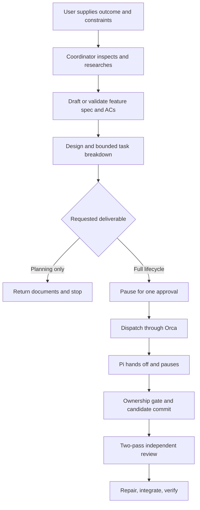

# Agentic SDD orchestration: plan

Version 0.4, 14 October 2026. Status: planning only. Neither implementation nor the spike is authorized by this document.

`orchestration-spec.md` holds requirements and invariants. `orchestration-controls.md` holds mechanisms. This document holds sequence, the spike checklist, pilot thresholds and open inputs.

## 1. Architecture

Claude coordinates. Orca provides cross-CLI task, session, messaging and worktree state. A thin native Claude entrypoint loads the shared workflow and role map. Every specialist receives a role prompt and an explicit brief through the same Orca dispatch path; native launch recipes select runtime, model, effort and permissions. Spec drafting, file operations, research tools and ordinary Git stay native. Repository documents own intent, Orca owns operational state, Git owns revisions; an ignored recovery note and audit log connect them.

Baseline bindings: Opus 5.5 coordinating; the user's tested Pi/DeepSeek 4.1 Flash high implementing; Codex Astra max advising and debugging, high reviewing; Claude Sonnet 5.5 high researching, rebindable to a verified Codex recipe.

## 2. Artifacts

| Artifact | Location and owner |
| --- | --- |
| Coordinator entrypoint | `.claude/agents/sdd-orchestrator.md`, global or project scope |
| Role pack: workflow, role map, five prompts, launch recipes | `~/.agents/orca-sdd/` or `<project>/.agents/orca-sdd/`, versioned |
| Feature spec and plan | Repository convention, coordinator-maintained, committed before implementation |
| Brief envelope, receipt, audit schemas | Controls appendices A to C |
| Recovery index | `<integration>/.agent-task.md`, ignored, coordinator-only (K-11) |
| Audit log and run artifacts | `<integration>/.agents/orca-sdd/runs/<feature-id>/`, ignored (K-12) |

Verify ignore rules before the first run. Task writers never own feature docs, role pack, recovery or audit paths (K-7).

## 3. User workflow

- **Setup, later:** confirm spike evidence, native clients and effective permissions; preserve authentication and the tested Pi configuration; choose scope; preview and install the pack.
- **Kickoff:** provide outcome, constraints and references. Claude researches, produces or validates feature documents, checks readiness, pauses once for approval, then executes within scope.
- **Planning-only:** same initial stages; returns documents, acceptance checks and open decisions. Read-only research may run through Orca. Nothing else is authorized.
- **Resume:** reconcile recovery index, audit log, Orca and Git before any dispatch (R-2). Restart does not replace approval, reset budgets or refresh a stale result.

## 4. Work packages

| Step | Deliverable | Entry | Exit evidence |
| --- | --- | --- | --- |
| P0a | Settled assumptions and spike checklist | Documentation | D-1 fixed; checklist agreed; no feasibility claimed |
| P0b | Orca feasibility spike | Scoped authorization, disposable repo | Every row in section 5 recorded as pass, fail or inconclusive within 8 hours; versions pinned (K-17) |
| P0c | Feasibility decision | P0b evidence | All essential rows pass, or P0 stays open and the integration is revised |
| P1 | Brief validator, ownership gate, audit writer, usage recorder, fake-worker harness | P0 closed, implementation authorized | Invalid briefs rejected; events correlated; missing telemetry detected; harness exercises K-2, K-5, K-6, K-7, K-11, K-12, K-14 |
| P2 | Entrypoint, workflow, five prompts, launch recipes, review and spec-drift gates | P1 | AC-1, AC-2, AC-10 observed; remaining ACs covered by harness or explicit scenario |
| P3 | One real Pi task end to end | P2 | Preflight, gate, candidate, two-pass review, integration; correct model and identities; usage recorded |
| P4 | Consultation and recovery drills | P3 | Dirty-file advice, timeout, restart, cancellation, spec change, stalled worker, human takeover |
| P5 | Measured pilot | P3, P4, pilot authorization | Section 6 thresholds met with human-audited evidence |
| P6 | Installer and operator docs | Stable P1 to P5 | AC-13; lifecycle rechecked with freshly installed entrypoints |
| P7 | Adoption decision | P5, P6 | Thresholds met, limitations listed, adopt or revise |

## 5. Spike checklist

Maximum one working day, start and end recorded. Manual receipts suffice (T0). Record versions, sanitized evidence and pass, fail or inconclusive per row.

| Question | Required observation |
| --- | --- |
| Can Orca attach to the tested Pi session and inject its task? | Correct model and effort; exact task received once; real task and dispatch IDs; no blind resend after uncertain delivery |
| Can Codex stay read-only and still report? | Harmless write refused by native control; source inspection and Orca result delivery succeed |
| Can Codex research under the same read-only profile? | Context7 query succeeds inside the sandbox used for review; if not, the researcher binding is documented as unsupported |
| Does completion survive replay and restart? | Receipt recorded; identical replay after restart is ignored; conflicting result surfaced, not overwritten |
| Does ask timeout preserve the question? | Pi stays paused; advisor sees dirty and new files; reply to the original ID resumes the same assignment; no inbox deadlock |
| What can Pi restrict, and what usage is measurable? | Native write limits documented; synthetic out-of-assignment change detected manually; token or cost counters captured for Pi, Codex and coordinator, or their absence recorded |
| Does Orca expose worker idle or heartbeat state? | Documented either way; feeds K-14 defaults |

Native Pi host containment is not assumed (N-1, N-2). Only fixture work is allowed until the accepted deployment scope addresses it.

## 6. Pilot thresholds

Isolated non-production repository. Automated checks, manual observations and untested assumptions recorded separately with AC references.

| Measure | Threshold |
| --- | --- |
| Sample | Ten completed tasks: four small features, three bug fixes, three integration or regression tasks, all meeting approved ACs |
| Integrity | Zero lost work, duplicate accepted results or accepted ownership violations |
| Recovery drills | Three restarts, two ask timeouts, one cancellation during active implementation, one spec-change drill, one stalled-worker drill, one worker-waiting-on-ask drill that must not trigger a stall, one human takeover, one integration revert followed by repair where the full feature must be present in the final integrated SHA; all recover with complete accounting |
| Reviewer calibration | Per K-19: at least four of five seeded defects caught, every critical or high seed caught, at most one false positive across five controls |
| Human intervention | At most two unplanned interventions across the ten ordinary tasks; approvals, drills and calibration counted separately |
| Usage coverage | 100% of dispatches and coordinator sessions have time and attempt records. Token or cost telemetry is recorded where the runtime exposes it; gaps are listed and block cost-based routing claims, not adoption (D-12) |
| Human time | Budget two to three user days: approvals, seed authoring, adjudication, drills, intervention classification. Overrun is recorded, not hidden |

An unplanned intervention is any human action needed to rescue or correct ordinary orchestration beyond the scheduled approval. Accumulating ten successes does not cancel a failed integrity or recovery gate.

## 7. Open inputs

- Before the spike: disposable repository, exact installed clients, verified Pi invocation, agreed checklist, scoped authorization.
- Before the pilot: ten-task sample, required checks, calibration inventory, integration convention, time and attempt budget, any dollar cap.
- Confirm D-11 (two dispatches for review) and D-12 (telemetry decoupled from adoption).
- After evidence: parallel writers, debugger ownership transfer, other platforms, routing changes.
